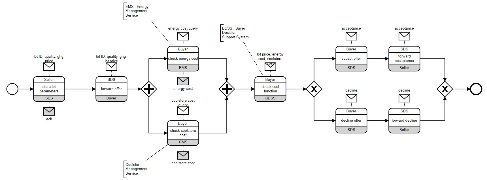

# BRAIN 2023 Tutorial
In this tutorial you can reproduce all the test used to write the paper for BRAIN 2023 workshop.

## Preliminaries
In the following we suggest a sequence of commands to test how the on-chain enforcer works. The following commands have been tested using Ganache and Sepolia .

Once you have activated the environment, you have to move in the bpmn2solidity folder and you can launch the CLI with the command `django-admin cli`. The following steps you have to run are the following:
1. Execute the command `init` for inizialing the application (only the first time)
1. If this is the first time, execute the command `load <path/brain2023_running_example.bpmn>`. Otherwise execute the command `load brain2023_running_example`. Both commands load the choreography used for all the test
1. Execute the command `env ONCHAIN_URL = <your_ganache_url>` to set the URL of your test blockchain
1. Execute the command `env ONCHAIN_ID = <your_ganache_id>` to set the chain ID of your test blockchain
1. Execute the command `env ONCHAIN_ADDRESS = <your_wallet_address>` to set the address of your wallet
1. Execute the command `env ONCHAIN_PRIVATE_KEY = <your_private_key>` to set the private key associated with your adderss
1. Execute the command `start` for starting the enforcer and for generating and deploying the smart contract in the blockchain.

Note that after the `start` command the prompt changes to the following value: `+>`. This means that the enforcer is running and ready to process events provided by the user.

Note also that the tool *does store* your private key and address in the `${HOME}/.choen_cli` file, which is a history file. You can safely remove the file when you finish the experiments.

The choreography used for this example is the following.


## Correct execution without event buffered
The first test aims to verify a correct execution of the choreography without buffering any events, so the idea is to trigger only the receive now rules. To check what are the allowed transitions you can execute the command `/dump transitions` once the enforcer has been started. In this case you have to obtain a the following result (except for the id of the state that are causal and change at every execution):
```
 * State(epscrmlx) -[SDS?lot_ID,_quality,_ghg,_price]-> State(huhaaktq)
 * State(bzexvtlu) -[]-> State(epscrmlx)
   State(glaoaszy) -[Seller?ack]-> State(mahaqzvp)
   State(huhaaktq) -[]-> State(glaoaszy)
   State(igwepomk) -[Buyer?lot_ID,_quality,_ghg,_lot_price]-> State(xorqfcdq)
   State(mahaqzvp) -[]-> State(igwepomk)
   State(bfasuleu__bwratkop) -[CMS?coolstore_cost_query]-> State(bfasuleu__afperops)
   State(bfasuleu__bwratkop) -[EMS?energy_cost_query]-> State(jbuxtkyu__bwratkop)
   State(bfasuleu__afperops) -[]-> State(bfasuleu__vixpswlc)
   State(bfasuleu__afperops) -[EMS?energy_cost_query]-> State(jbuxtkyu__afperops)
   State(bfasuleu__vixpswlc) -[Buyer?coolstore_cost]-> State(bfasuleu__xnzticdz)
   State(bfasuleu__vixpswlc) -[EMS?energy_cost_query]-> State(jbuxtkyu__vixpswlc)
   State(bfasuleu__xnzticdz) -[EMS?energy_cost_query]-> State(jbuxtkyu__xnzticdz)
   State(jbuxtkyu__bwratkop) -[CMS?coolstore_cost_query]-> State(jbuxtkyu__afperops)
   State(jbuxtkyu__bwratkop) -[]-> State(vduzbvdn__bwratkop)
   State(jbuxtkyu__afperops) -[]-> State(vduzbvdn__afperops)
   State(jbuxtkyu__afperops) -[]-> State(jbuxtkyu__vixpswlc)
   State(jbuxtkyu__vixpswlc) -[Buyer?coolstore_cost]-> State(jbuxtkyu__xnzticdz)
   State(jbuxtkyu__vixpswlc) -[]-> State(vduzbvdn__vixpswlc)
   State(jbuxtkyu__xnzticdz) -[]-> State(vduzbvdn__xnzticdz)
   State(vduzbvdn__bwratkop) -[CMS?coolstore_cost_query]-> State(vduzbvdn__afperops)
   State(vduzbvdn__bwratkop) -[Buyer?energy_cost]-> State(ltdvcyso__bwratkop)
   State(vduzbvdn__afperops) -[]-> State(vduzbvdn__vixpswlc)
   State(vduzbvdn__afperops) -[Buyer?energy_cost]-> State(ltdvcyso__afperops)
   State(vduzbvdn__vixpswlc) -[Buyer?coolstore_cost]-> State(vduzbvdn__xnzticdz)
   State(vduzbvdn__vixpswlc) -[Buyer?energy_cost]-> State(ltdvcyso__vixpswlc)
   State(vduzbvdn__xnzticdz) -[Buyer?energy_cost]-> State(ltdvcyso__xnzticdz)
   State(ltdvcyso__bwratkop) -[CMS?coolstore_cost_query]-> State(ltdvcyso__afperops)
   State(ltdvcyso__afperops) -[]-> State(ltdvcyso__vixpswlc)
   State(ltdvcyso__vixpswlc) -[Buyer?coolstore_cost]-> State(ltdvcyso__xnzticdz)
   State(xorqfcdq) -[]-> State(bfasuleu__bwratkop)
   State(bpxdsqlg) -[BDSS?lot_price,_energy_cost,_coolstore_cost]-> State(pznutvwx)
   State(ltdvcyso__xnzticdz) -[]-> State(bpxdsqlg)
   State(qzehqjoy) -[SDS?acceptance]-> State(zncymiff)
   State(ozrmadio) -[Seller?acceptance]-> State(sydmtkhy)
   State(zncymiff) -[]-> State(ozrmadio)
   State(rihiocnj) -[]-> State(dszlzkkm)
   State(rihiocnj) -[]-> State(qzehqjoy)
   State(dszlzkkm) -[SDS?decline]-> State(solosftn)
   State(hzuupmql) -[Seller?decline]-> State(omubcauv)
   State(solosftn) -[]-> State(hzuupmql)
   State(pznutvwx) -[]-> State(rihiocnj)
   State(omubcauv) -[]-> State(oizxtrjv)
   State(sydmtkhy) -[]-> State(oizxtrjv)
```
So based on the previous transitions, a possibile stream of events to achieve our goal is the following:
```
SDS?lot_ID,_quality,_ghg,_price Seller?ack Buyer?lot_ID,_quality,_ghg,_lot_price EMS?energy_cost_query Buyer?energy_cost CMS?coolstore_cost_query Buyer?coolstore_cost BDSS?lot_price,_energy_cost,_coolstore_cost SDS?acceptance Seller?acceptance
```
Copying the stream of events in the CLI, the expected output is the following:
```
** Process input: SDS?lot_ID,_quality,_ghg,_price ... **
(* Condition rule receive now: SDS?lot_ID,_quality,_ghg,_price *)

Output message: SDS?lot_ID,_quality,_ghg,_price

** Process completed. **


** Checking for usable messages in buffer ...
(* No usable message found in buffer for current states. *)
** Checking completed. **


** Process input: Seller?ack ... **
(* Condition rule receive now: Seller?ack *)

Output message: Seller?ack

** Process completed. **


** Checking for usable messages in buffer ...
(* No usable message found in buffer for current states. *)
** Checking completed. **


** Process input: Buyer?lot_ID,_quality,_ghg,_lot_price ... **
(* Condition rule receive now: Buyer?lot_ID,_quality,_ghg,_lot_price *)

Output message: Buyer?lot_ID,_quality,_ghg,_lot_price

** Process completed. **


** Process input: EMS?energy_cost_query ... **
(* Condition rule receive now: EMS?energy_cost_query *)

Output message: EMS?energy_cost_query

** Process completed. **


** Checking for usable messages in buffer ...
(* No usable message found in buffer for current states. *)
** Checking completed. **


** Process input: Buyer?energy_cost ... **
(* Condition rule receive now: Buyer?energy_cost *)

Output message: Buyer?energy_cost

** Process completed. **


** Checking for usable messages in buffer ...
(* No usable message found in buffer for current states. *)
** Checking completed. **


** Process input: CMS?coolstore_cost_query ... **
(* Condition rule receive now: CMS?coolstore_cost_query *)

Output message: CMS?coolstore_cost_query

** Process completed. **


** Checking for usable messages in buffer ...
(* No usable message found in buffer for current states. *)
** Checking completed. **


** Process input: Buyer?coolstore_cost ... **
(* Condition rule receive now: Buyer?coolstore_cost *)

Output message: Buyer?coolstore_cost

** Process completed. **


** Checking for usable messages in buffer ...
(* No usable message found in buffer for current states. *)
** Checking completed. **


** Process input: BDSS?lot_price,_energy_cost,_coolstore_cost ... **
(* Condition rule receive now: BDSS?lot_price,_energy_cost,_coolstore_cost *)

Output message: BDSS?lot_price,_energy_cost,_coolstore_cost

** Process completed. **


** Checking for usable messages in buffer ...
(* No usable message found in buffer for current states. *)
** Checking completed. **


** Process input: SDS?acceptance ... **
(* Condition rule receive now: SDS?acceptance *)

Output message: SDS?acceptance

** Process completed. **


** Checking for usable messages in buffer ...
(* No usable message found in buffer for current states. *)
** Checking completed. **


** Process input: Seller?acceptance ... **
(* Condition rule receive now: Seller?acceptance *)

Output message: Seller?acceptance

** Process completed. **


** Checking for usable messages in buffer ...
(* No usable message found in buffer for current states. *)
** Checking completed. **

(* Ended *)
```
As said in the beginning no event is added to the enforcer buffer, but every event triggers the rule `receive_now` and so the choreography moves starightforward at the next available state.

## Correct execution with buffered event
The second test aims to check the other rules, i.e. `receive_delayed` and `receive_buffered`.
Imagine that in the initial state you send the event `SDS?lot_ID,_quality,_ghg,_price`. It triggers the rule receive now and a transitions is generated in the automaton associated with the choreography. The possibile transitions in the new state are the following:
```
 * State(ywdwzqdf) -[Seller?ack]-> State(hdgwceud)
 * State(crprzznl) -[]-> State(ywdwzqdf)
```
In this case imagine that we want to force the system to move forward without waiting the acknowledge message. For example, we try to send the event `Buyer?lot_ID,_quality,_ghg,_lot_price`. In this case in the terminal we can see the following output:
```
** Process input: Buyer?lot_ID,_quality,_ghg,_lot_price ... **
(* Condition rule receive delayed: Buyer?lot_ID,_quality,_ghg,_lot_price *)
** Process completed. **


** Checking for usable messages in buffer ...
(* No usable message found in buffer for current states. *)
** Checking completed. **
```
The rule receive delayed is triggered and the event is added to the buffer of the enforcer. You can check it using the command `/history`.
Therefore, to move forward in the choreography the only event allowed is `Seller?ack`. However, in this particular case, sending this event to the enforcer, the rule receive buffered is triggered because in the new states reached by the event `Seller?ack`, the previuos event added in the buffer can be used. In fact, the output that is showed sending the event `Seller?ack` is the following:
```
** Process input: Seller?ack ... **
(* Condition rule receive now: Seller?ack *)

Output message: Seller?ack

** Process completed. **


** Checking for usable messages in buffer ...
(* Condition rule receive buffered: Buyer?lot_ID,_quality,_ghg,_lot_price *)

Output message: Buyer?lot_ID,_quality,_ghg,_lot_price

(* No usable message found in buffer for current states. *)
** Checking completed. **
```

## Enforcement test
The third test aims to buffer one event sent by the user, but it will not be used because of the evolution of the choreography. 
For example, imagine that we send the following stream of event:
```
SDS?lot_ID,_quality,_ghg,_price Seller?ack Buyer?lot_ID,_quality,_ghg,_lot_price EMS?energy_cost_query Buyer?energy_cost CMS?coolstore_cost_query Buyer?coolstore_cost BDSS?lot_price,_energy_cost,_coolstore_cost
```
With this set of events the choreography change its state going to the task called "check cost function". At this point the user send the event `Seller?decline`, but it is added to the enforcer buffer, because it is not usable in the current states of the automaton.
```
** Process input: Seller?decline ... **
(* Condition rule receive delayed: Seller?decline *)
** Process completed. **


** Checking for usable messages in buffer ...
(* No usable message found in buffer for current states. *)
** Checking completed. **
```
However, in this case the user does not send the event `SDS?decline` and so using the event added into the buffer. In fact the user can decide to follow the other branch and so it send to the CLI the events `SDS?acceptance`,`Seller?acceptance`. As we can see 
with the command `/history` the previous event remains in the buffer of the enforcer.
```
...

event : BDSS?lot_price,_energy_cost,_coolstore_cost
curr_states : ['pxqjhase', 'fpndpsly', 'bhcvemvr', 'rximwfhf']
buffer : []


event : Seller?decline
curr_states : ['pxqjhase', 'fpndpsly', 'bhcvemvr', 'rximwfhf']
buffer : ['Seller?decline']


event : SDS?acceptance
curr_states : ['dfujdivz', 'hnymfogm']
buffer : ['Seller?decline']


event : Seller?acceptance
curr_states : ['fhfqoovt', 'rrggtafi']
buffer : ['Seller?decline']
```

